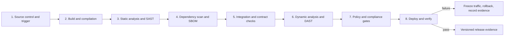
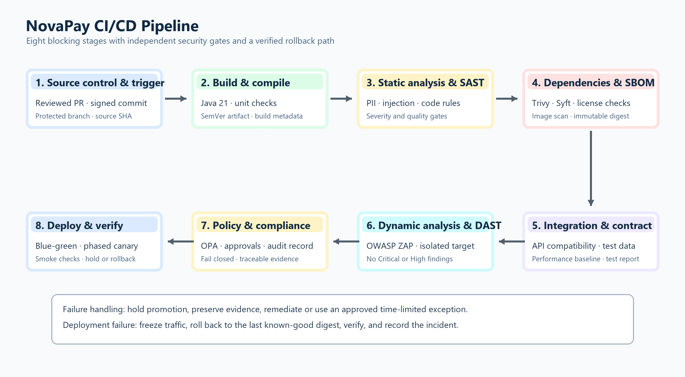

# Deliverable 1: CI/CD Pipeline Architecture

## Purpose

This design defines an auditable path from a reviewed source change to a verified deployment of the NovaPay demo. It follows the assessment's eight canonical stages. The deployed service remains a local simulator; all banking controls described here are design targets and do not claim production or RBI/PCI-DSS certification.

## Scope and assumptions

- Application: Java 21, one small HTTP service, no third-party Java libraries today.
- Repository: GitHub repository containing the `DOC5A-CICD-Pipeline-Aditi` project directory.
- Local tools already available: Trivy 0.74.0, Syft 1.54.0, OPA 1.21.1, Helm 3.22.0, and a JDK capable of targeting Java 21.
- A container image, registry, Kubernetes cluster, DAST target, and GitHub branch protection are not currently configured. Their gates must remain visible as pending; they must not be marked passed using placeholder values.
- The assessment proposes managed Kubernetes, JFrog Artifactory, GitHub Enterprise, Terraform, Argo CD, Istio, Prometheus, Grafana, SonarQube, OWASP ZAP, Trivy, and OPA. The local demonstration substitutes free tools where practical and records the difference.

## Pipeline overview

The editable Draw.io source and high-resolution export are stored beside this document. Each stage's inputs, outputs, gates, failure handling, retry/skip rules, and service target are specified in `stage-details/`.

## Execution and control flow

1. A pull request runs validation against a short-lived branch. A change cannot merge to `main` until the required review, signed-commit check, and blocking gates pass.
2. Compilation and unit checks produce a versioned build artifact. Independent source analysis and dependency inventory run in parallel where their inputs are ready.
3. The container is built only from the approved commit. Trivy scans the image; Syft produces a CycloneDX SBOM. The image is signed and its provenance recorded before it can be promoted.
4. Integration, contract, and DAST checks use an isolated non-production environment and synthetic data. Security gates cannot be skipped for hotfixes.
5. OPA evaluates the rendered Kubernetes resources, image registry/digest, privileges, and resource limits. Compliance evidence is attached to the commit and release identifier.
6. The artifact promotes through dev, staging, pre-production, and production without rebuilding. Production uses blue-green traffic switching and a staged canary with automated hold/rollback thresholds. Named approvers enforce separation of duties.
7. Health, synthetic transaction, service-level, and audit checks determine whether the release is marked stable. A failed or incomplete check holds promotion; an active rollback signal restores the last known-good revision.

## Stage service targets

Targets below are design budgets for the demo pipeline, not measured production SLAs. Security and approval waits are not shortened to meet a time budget.

| Stage | Target | Blocking outcome |
| --- | ---: | --- |
| 1. Source control and trigger | 2 minutes | Reject unreviewed, unsigned, or untrusted source |
| 2. Build and compilation | 5 minutes | Stop on compile, test, reproducibility, or coverage failure |
| 3. Static analysis and SAST | 5 minutes | Stop on threshold breach or unavailable required result |
| 4. Dependency scan and SBOM | 8 minutes | Stop on prohibited CVE/license or missing SBOM |
| 5. Integration and contract checks | 10 minutes | Stop on failed contract, API compatibility, or baseline check |
| 6. DAST | 10 minutes | Stop on Critical/High finding or unaudited exception |
| 7. Policy and compliance gates | 3 minutes | Reject any failed required policy or missing evidence |
| 8. Deploy and verify | 20 minutes per non-production rollout | Hold or roll back on health, smoke, synthetic, or canary failure |

The eight stages run in the listed order, for a 63-minute non-production critical-path target under these budgets. The production 24-hour bake is a post-deployment observation window and is not part of that build-time target.

## Security, audit, and release rules

- Use GitHub Flow with short-lived branches, required pull-request review, signed commits, and branch protection. A hotfix can use an expedited review path but still runs every security and compliance gate.
- Tag releases as `MAJOR.MINOR.PATCH+<git-sha>.<run-id>`. Record the source commit, build timestamp, workflow run, tool versions, test results, scan results, SBOM digest, image digest, approvals, deployment environment, and rollback decision.
- Publish immutable image digests, never deploy a mutable `latest` tag. Sign the image and verify provenance before deployment.
- Store secrets in a managed secret store for a real environment. No secret belongs in source, image layers, command output, or evidence artifacts.
- Keep a machine-readable audit record for both pass and fail outcomes. Each exception needs a finding, impact, compensating control, named approvers, creation/expiry time, and closure evidence. Expired exceptions fail closed.
- Never send real payment data to test environments. Use synthetic records locally and masked/anonymised datasets only where an approved test environment exists.

## Assessment mapping and current implementation

| Assessment requirement | Current evidence | Remaining work |
| --- | --- | --- |
| Eight canonical stages | This design and stage files | Implement the missing automated gates and environment path |
| Source/build stage | Java demo and manual workflow | Pull-request triggers, tests, review/signing enforcement, immutable build metadata |
| SAST, dependency scan, SBOM | Local source rule, Trivy scan, Syft SBOM | Add a maintained SAST engine and enforce CI thresholds; add lockfile/dependency data if libraries are introduced |
| Integration, contract, and DAST | Not configured | Create safe local targets, contracts, test data, and ZAP automation |
| Policy gate | Three Rego policies | Expand regulatory mapping, exception controls, Kyverno examples, and auditable gate outputs |
| Deployment and verification | Helm blue-green slots and local scripts | Build/run image, configure cluster/registry, automate canary statistics, approvals, and real rollout evidence |

## Limitations

The local source scan found no Java dependency manifests, so it cannot establish third-party dependency vulnerability coverage. The current local Trivy run is not a container-image scan. Placeholder registry values are not deployable images. The project must report these as gaps rather than claim clean production controls.

## AI attribution

Generative AI assisted with drafting and code review. Aditi Chandra is responsible for reviewing, adapting, and presenting this work.
