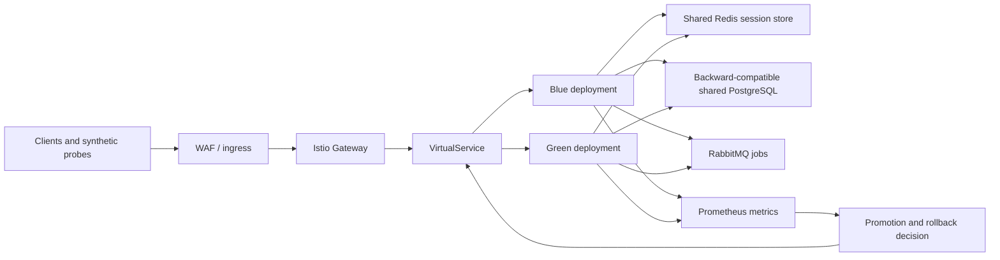

# Deliverable 2: Blue-Green and Canary Deployment Strategy

## Scope

This design follows assessment sections A.3 and D3 Day 4. It is a reference design for the fictional NovaPay environment. The project currently has a Helm blue-green chart and decision scripts, but it does not have Istio, a Kubernetes cluster, Redis, a database, a registry, or live traffic. No step below claims a real zero-downtime deployment has been executed.

## Target topology

Blue and green run the same immutable image digest in separate deployment slots. In the assessment production design, use the specified `novapay-prod-blue` and `novapay-prod-green` namespaces, while both connect to approved shared data services. In the local demo, Helm models the slots and Services without provisioning those production services.

## Blue-green traffic switch: five steps

1. **Check the idle slot.** Confirm the current stable route, image digest, chart revision, database compatibility, and rollback target. Confirm the candidate slot has no stale pods or traffic.
2. **Deploy the candidate.** Install the approved digest into the inactive slot. Wait for startup, liveness, and readiness checks; verify resource/security policy and pod image digests.
3. **Validate without user traffic.** Send synthetic health and transaction-simulation requests through the preview route. Check version/SHA, logs, metrics, and connection-drain readiness. Any failed or missing signal means HOLD.
4. **Approve and switch atomically.** The Release Manager and SRE Lead approve the same evidence record. Update the Istio VirtualService route from the old color to the new color in one reviewed change. Preserve the previous route and digest for rollback.
5. **Drain and observe.** Stop new requests to the old slot; allow normal HTTP requests to finish for 30–60 seconds and queued/payment-like demo work up to a configured five-minute drain window. Confirm no in-flight work remains before scaling down. Continue the 24-hour post-release bake.

The database schema must remain compatible with both application revisions throughout the switch. A contract migration is a separate approved release, never coupled to an immediate rollback.

## Session and work handling

- Use a shared Redis session store so a route switch does not depend on in-memory sessions from one color.
- Use idempotency keys for the payment simulation and do not replay an authorization as a recovery action.
- Stop accepting new long-running jobs on the old slot, finish or safely requeue in-flight work, and record unfinished jobs before removing the slot.
- Terminate TLS at the approved ingress/service-mesh boundary and use mTLS between services in the production design. The local Java demo uses synthetic traffic only.

## Four-phase canary plan

Use the same candidate digest and configuration as the full rollout. Compare the candidate to a rolling seven-day stable baseline with time-of-day and traffic-shape alignment. Do not advance if the sample is too small, metrics are missing, or the statistical result is inconclusive.

| Phase | Candidate traffic | Minimum observation | Promotion conditions | Failure action |
| --- | ---: | ---: | --- | --- |
| Canary | 1–2% | 15 minutes | Error rate <0.1%; p99 <200 ms; health checks pass; no Critical alert | Automatic rollback/traffic to 0% |
| Early adopter | 5–10% | 30 minutes | Error rate <0.05%; no Critical alert; required checks remain green | Automatic rollback/traffic to 0% |
| Expansion | 25–50% | 60 minutes | All SLOs met; no degradation versus baseline | Hold, investigate, or roll back |
| Full rollout | 100% | 24-hour bake | Complete SLO compliance for the full bake | Mark stable only after evidence; otherwise roll back |

## Statistical promotion rule

- Use Welch's t-test for the request-latency sample comparison and a chi-squared test for candidate-versus-baseline error proportions.
- Use a 95% confidence interval and a 0.05 significance threshold. A statistically inconclusive result is HOLD, not automatic promotion.
- Require practical thresholds in the phase table as well as statistical significance; a statistically significant but operationally unacceptable regression still blocks promotion.
- Track a weighted composite regression score across errors, latency, and resource utilisation. Proposed initial weights are 50% errors, 30% latency, and 20% CPU/memory; calibrate them against synthetic demo traffic before treating them as production policy.
- Use the rolling seven-day baseline described by the assessment. Record sample counts, time window, test method, p-value, confidence interval, threshold result, and decision in the release evidence.

## Rollback boundary

The independent rollback path changes traffic back to the last known-good immutable digest and prior configuration. It must remain operable if the candidate deployment or its pipeline job is broken. Apply the category thresholds in Deliverable 6; this strategy does not replace the detailed trigger taxonomy or incident playbook.

## Current implementation boundary

The chart models blue/green Deployments and preview/stable Services. The candidate checker reads health/version endpoints, and the promotion script prints plan-only Helm commands after a fresh passing report. The canary evaluator consumes operator-supplied metrics and prints a decision; it does not run statistical tests, query Prometheus, alter Istio routes, or execute rollback commands. Those are explicit remaining tasks.

## AI attribution

Draft created with generative AI assistance; owner review is pending.
