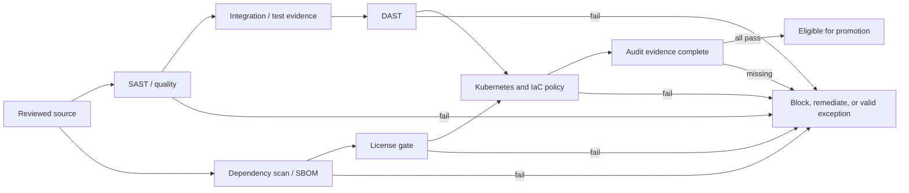

# Deliverable 3: Compliance Gate Specifications

## Scope and regulatory mapping

This design maps controls to the assessment's listed RBI Master Direction on IT Risk sections and PCI-DSS v4.0 requirements. It is an educational mapping for a fictional bank, not a legal interpretation, audit opinion, or certification. Gate execution must fail closed when a required scan or policy result is missing.

The assessment contains two dependency thresholds: Stage 4 blocks Critical and High findings above CVSS 8.0, while its gate table describes Critical CVEs and a CVSS 9.0/72-hour remediation window. This design uses the stricter release rule: block all Critical and High findings above CVSS 8.0. The 72-hour window is a remediation deadline for non-release-blocking findings; it is not permission to ship a blocking finding.

## Gate catalogue

| ID | Gate and tool | Pass threshold | Regulatory mapping | Failure response |
| --- | --- | --- | --- | --- |
| G1 | SAST and code quality; Semgrep CE 1.180.0, coverage from Java test reports | 0 Critical; no more than 2 High; new-code technical debt ≤5%; line coverage ≥80%, branch coverage ≥70% | RBI 5.1; PCI-DSS 6.2 | Block merge; open finding with rule/location/remediation; security owner triages |
| G2 | DAST; OWASP ZAP 2.17.0 | 0 Critical and 0 High, including applicable OWASP Top 10/API findings | RBI 5.1; PCI-DSS 6.4 and 11.3 | Block promotion; remediate and rescan; false-positive request needs TRC risk acceptance and expiry |
| G3 | Dependency, image, and SBOM; Trivy 0.74.0 and Syft 1.54.0 | CycloneDX SBOM present; 0 Critical; block High with CVSS >8.0; no unapproved GPL/AGPL/SSPL dependency; image digest immutable and provenance verified | RBI 5.1 and 7.2; PCI-DSS 6.3 | Block artifact promotion; upgrade/remove package or image; attach rescan evidence |
| G4 | License compliance; Syft inventory plus legal policy | 0 GPL/AGPL/SSPL components without written Legal approval; all components have detected or explicitly unknown license status | RBI 7.2 | Block release; legal review and approved replacement/exception record |
| G5 | Kubernetes policy; OPA 1.21.1 and Helm 3.22.0 | 100% of rendered resources pass; immutable approved-registry image digest; no privileged containers; non-root; CPU and memory requests/limits present | RBI 4.2, 4.3, 5.4; PCI-DSS 6.5 | Deny deployment; show policy ID and offending resource; dual approval is required for an eligible exception |
| G6 | Infrastructure policy; Checkov/Terraform (versions pinned before IaC implementation) | 0 Critical/High IaC findings; no privileged workloads; required network/data encryption controls present; no public administrative endpoint | RBI 4.2, 4.3, 5.4; PCI-DSS 6.5 | Block plan/apply; fix module or request time-limited Tech Lead exception with compensating control |
| G7 | Change/audit evidence; pipeline record and immutable artifact store | 100% of release records include source SHA, reviewer/approver identities, gate outcomes, tool versions, artifact/SBOM digests, environment, timestamps, and deployment/rollback result | RBI 4.2, 6.1; PCI-DSS 6.5 and 10.2 | Block promotion if evidence is incomplete; repair record generation, never fabricate an approval |

G1 uses Semgrep for code findings and the build's coverage report for coverage thresholds. Semgrep alone does not calculate test coverage or the debt ratio; the pipeline must combine those separately measured values before deciding G1.

## Exception workflow

1. The finding owner submits a structured request with gate/finding IDs, affected commit and image digest, business impact, exploitability, compensating controls, remediation owner/date, and proposed expiry.
2. A required independent approver reviews the request: CISO/security for SAST, TRC risk acceptance for DAST, Legal for licenses, dual security/platform approval for eligible Kubernetes policies, Tech Lead for eligible IaC exceptions. The requester cannot approve their own exception.
3. The approval binds to the exact finding and artifact digest, includes created/expiry times, and is stored with the audit record. A new digest or changed finding requires a new decision.
4. Default expiry is 24 hours for security/policy exceptions; an approved license exception can last at most 30 days with a replacement plan. No Critical vulnerability, privileged-container, missing-approval, or missing-audit-evidence exception can authorize a production release.
5. Expired exceptions fail closed. The owner must remediate, obtain a fresh approval before expiry, or keep the release blocked. Closure stores the fix and clean rescan evidence.

The PDF's 72-hour dependency remediation window is tracked as an SLA for findings below the release-blocking threshold. Blocking findings stay blocked until fixed.

## Structured audit record

Every gate emits one JSON record per evaluation. The schema is `gate-audit.schema.json`. Records are append-only and link to the source SHA, image digest, policy/scanner version, finding IDs, decision, and any exception. A later remediation creates a new record linked by `supersedes`; it does not overwrite the original failure.

## Gate orchestration

## Current evidence and gaps

Three OPA policies currently check image digest/registry, resource limits, and privileged containers. OPA syntax and representative allow/deny inputs were evaluated locally. The local source rule is not a full SAST tool; current Trivy filesystem scanning found no dependency manifests and did not scan a built container image. None of those results alone demonstrates all seven gates are operational.

## AI attribution

Draft created with generative AI assistance; owner review is pending.
