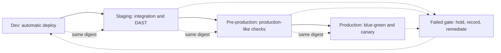

# Deliverable 5: Environment Promotion Strategy

## Promotion path

Promote one immutable image digest through four environments. Build once from a reviewed source SHA; do not rebuild or retag different bytes between environments.

The dotted arrows indicate artifact identity: every environment receives the image with the same digest. Configuration and secrets vary by environment through separately controlled values and secret references.

## Environment controls

| Environment | Purpose and deployment | Required checks | Approval |
| --- | --- | --- | --- |
| Dev | Automatic after merge to the protected main branch; synthetic data only | Startup/readiness, unit and smoke checks, OPA policy, image digest recorded | No manual approval; authorized merge is the change approval |
| Staging | Promote the dev-tested digest; integration, contract, and DAST checks | API compatibility, DAST 0 Critical/High, synthetic transaction, resource policy, migration compatibility | Test owner confirms evidence; security owner resolves findings |
| Pre-production | Same digest and production-like topology/configuration shape; load and rollback rehearsal | Peak and soak performance, restore readiness, migration rehearsal, canary rule inputs, alert route and dashboard check | Service owner plus operations owner |
| Production | Blue-green deployment followed by staged canary and 24-hour bake | All compliance records complete, health and synthetic checks pass, latency/error thresholds hold, rollback target is available | Change approver and service owner; requester cannot self-approve |

No real payment card or customer data is used in non-production. Configuration is versioned without secrets; secret material is obtained at runtime from a managed secret store for a real deployment. The local demo uses synthetic values and must not commit credentials.

## Promotion invariants

1. The source SHA, image digest, SBOM digest, provenance, and gate record stay attached to one release identifier.
2. A digest that changes after scanning or approval restarts the required gates.
3. A missing, stale, failed, or expired gate result blocks promotion. An exception is valid only for its named finding and exact digest.
4. Environment configuration changes receive independent review and audit evidence; they do not rebuild the application image.
5. Production promotion uses named, separate identities for deploy, approve, and audit. A single person cannot both request and approve a production change.
6. Freeze windows and emergency releases use the same security gates. An emergency may shorten the approval wait only through the documented emergency process; it cannot skip evidence or rollback readiness.

## Promotion decision record

Each environment transition records:

- release ID, source SHA, image and SBOM digests, and build provenance;
- source and destination environment, configuration revision, and secret reference version (never secret values);
- required gate IDs, versions, results, timestamps, and evidence URIs;
- migration version/checksum and health-check results;
- requester, approver, deployment identity, and deployment timestamp;
- canary measurements, decision, rollback target, and final outcome.

The JSON shape for individual gate decisions is defined in `../03-compliance-gates/gate-audit.schema.json`. Environment promotion should link those records rather than replace or overwrite them.

## Rollback and hold rules

Promotion stops on any required gate failure, missing evidence, digest mismatch, failed migration compatibility check, or unhealthy service. In production, freeze further traffic expansion, route to the last known-good blue/green slot, verify the synthetic transaction and service health, and create an incident record. Database changes follow the compatibility rules in Deliverable 4; reverting the application does not automatically revert the schema.

## Current implementation boundary

The repository contains a hosted build/security workflow, Helm blue-green templates/scripts, and an Argo CD Project/ApplicationSet template for separately registered environment clusters. The ApplicationSet uses a reviewed source revision and registry/image digests supplied by the Argo CD cluster records, and requires manual sync. No GitHub-hosted environment approvals, immutable registry, Argo CD server, Kubernetes cluster, secret manager, or working production traffic is configured. Dev→staging→pre-production→production promotion is therefore a design/configuration target; it must not be reported as an executed cloud deployment.

## AI attribution

Draft created with generative AI assistance; owner review is pending.
